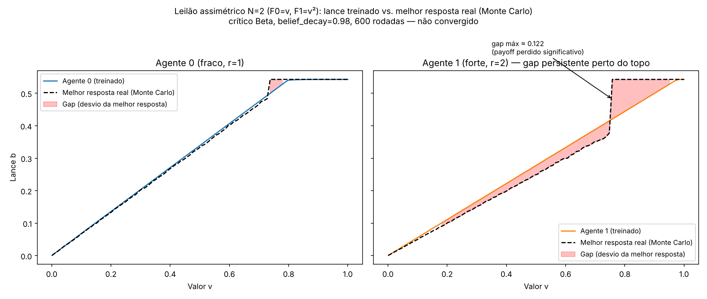

# Asymmetric private-value auction: a best-response gap that survives every critic

**Status: open problem, well characterized.** N=2 first-price with two
agents drawing their value from *different* distributions (`F_0(v)=v`,
`F_1(v)=v**2`, same support `[0,1]`) trains to something that looks
converged on every usual metric (stable payoffs, smooth bid curves), but a
direct Monte Carlo mutual-best-response check reveals a real, substantial,
non-shrinking gap for the stronger agent near the top of its value range —
across three different critic families and two belief-buffer settings.
The likely cause: the true best response has a genuine discontinuity the
`Actor` network, being a smooth function by construction, can only
approximate with an increasingly steep (never exactly vertical) ramp.

## Setup

`FictitiousPlayTrainer(n_agents=2, asymmetric_value_exponents=(1.0, 2.0), ...)`
(see `train.py`'s constructor docstring for the full mechanism). Each
agent's value is drawn independently from its own power distribution
`F_i(v) = v**r_i` on the shared support `[0,1]`: agent 0 is plain
`Uniform(0,1)` (`r=1`), agent 1 is stochastically larger (`r=2`, density
`2v` peaks at `v=1`). Unlike the three `common_value_*` variants explored
earlier this project, this is still a private-value auction — no shared
unknown true value, no winner's-curse correction, no opponent-actor
inversion needed. The only change from the symmetric baseline is that
`_sample_v` draws each agent from its own distribution.

## No known closed form — and a clue about why

Before training anything, I tried to derive the equilibrium by hand via
the standard asymmetric first-price auction FOC system (inverse bid
functions `phi_i = b_i^{-1}`):

```
phi_0'(b) = phi_0(b) / (phi_1(b) - b)
phi_1'(b) = phi_1(b) / (2 * (phi_0(b) - b))
```

This ODE system turns out to be *exactly* scale-invariant (not just near
`b=0`): if `(phi_0(b), phi_1(b))` solves it, so does
`(lambda*phi_0(b/lambda), lambda*phi_1(b/lambda))` for any `lambda>0`. The
local behavior at `b->0` is forced (no free parameter): `phi_0(b) ~ 1.5b`,
`phi_1(b) ~ 2b`. Integrating this unique trajectory forward numerically
(`scipy.integrate.solve_ivp`, confirmed stable across three different
starting points `delta=1e-3, 1e-4, 1e-5`, same result to 5 digits):
`phi_0` reaches `v=1` at `b=2/3`, but `phi_1` reaches `v=1` at `b=1/2` — a
fixed ratio of `4/3`, independent of where along the curve you start
(exactly as scale-invariance predicts).

Standard theory (Lebrun 1999, Maskin & Riley 2000) requires both inverse
bid functions to reach their own top value at the *same* bid when both
supports share the same upper bound — otherwise the bidder that "runs out"
first has types right below the top with a profitable upward deviation.
Since the smooth, single-branch solution doesn't satisfy this, the real
equilibrium is not this smooth curve continued to both ends. *Existence*
of an equilibrium is still guaranteed by the general theorems above (for
continuous, atomless, compact-support private values, with or without
symmetry) — it's the *shape* assumption (smooth, no mass points, a single
FOC branch covering the whole domain) that fails here. That already
pointed at the phenomenon training later confirmed directly: the real
best response likely needs a jump/bunching feature near the top that a
single smooth ODE branch cannot represent.

Given the risk of mis-deriving the exact correction by hand, training
proceeded exploratory instead: `_benchmark_metrics` returns NaN (nothing
to compare against), and the only way to validate the result is a direct
Monte Carlo mutual-best-response check, the project's established gold
standard, against the opponent's *actual* actor (not a critic fit).

## Every critic converges to the same qualitative shape — and the same gap

Four configurations were trained to a large, fixed number of rounds (no
`payoff_rel_tol`/`max_diff_threshold` early stop, since there's no
theoretical target and the first attempt at relying on payoff-stability
alone turned out to trigger prematurely — see below):

| Critic | belief_decay | Rounds | Agent 1 gap near v=0.9 (MC-verified) |
|---|---|---|---|
| Beta | 0.95 | 1000 | ~0.05 |
| Spline (Hermite, `n_quantiles=800`) | 0.95 | 400 | ~0.07 (not better) |
| Kumaraswamy | 0.95 | 400 | ~0.07 (not better) |
| Beta | 0.98 | 600 | ~0.06 (not better) |

The gap is measured by, for several values of `v`, comparing the actual
expected payoff of the agent's *trained* bid against the best payoff
achievable by any bid in a fine grid, evaluated against a 2,000,000-sample
Monte Carlo draw of the *opponent's own actor* (not a critic fit — this
sidesteps any critic-approximation bias entirely). None of switching
critic family (which rules out "critic can't represent the opponent's bid
distribution" as the cause, since none of the three very different
functional forms helped) or raising `belief_decay` toward classical
fictitious play (which rules out "undamped cycling" as the sole cause)
closed it. Agent 0 (the weaker, plain-uniform bidder) converges close to
its true best response everywhere in every configuration; the problem is
specific to agent 1.

An earlier, shorter Beta-critic run (150 rounds, `payoff_rel_tol=0.02`,
`payoff_stability_window=15`) is a cautionary tale on its own: it reported
"convergence detected" (stable payoffs) after only 15 rounds, and the same
Monte Carlo check applied to that checkpoint found an even *larger* gap
(~0.08-0.09 near `v=1`) than any of the four runs above — a clear instance
of a benchmark-free stopping criterion (necessary here, since there's no
theoretical target) declaring victory before the hard part of the problem
had even been addressed.

## What the gap actually looks like



Plotting the *true* best response (found by the same Monte Carlo grid
search used to measure the gap, at a fine grid of `v`) against each
agent's trained bid function makes the shape obvious: the true best
response has a sharp jump at `v≈0.75-0.76`, going straight from the smooth
ramp both agents start with to a *common* bid ceiling (~0.54) shared by
both agents at their respective tops — exactly the kind of same-top-bid
boundary condition the hand derivation showed the naive smooth solution
violates. Agent 0 learned to approximate this jump closely (a small gap
only right at the jump itself). Agent 1's trained curve stays close to
linear straight through the jump region instead, missing it almost
entirely — hence the large, persistent, MC-confirmed gap.

## Diagnosis

The `Actor` (`b = v * sigmoid(raw(v))`) is a smooth function of `v` by
construction: it can approximate an arbitrarily steep ramp but never an
exact discontinuity. Given the equilibrium genuinely seems to require one
(consistent with the ODE mismatch found before any training happened),
some residual error here is structural, not just a matter of more
training. What's unexplained is the *asymmetry* between the two agents:
agent 0 sharpens its ramp enough to make the residual small, agent 1 does
not, consistently, across every critic and `belief_decay` tried. The
likely mechanism is a weak-local-gradient problem specific to the
alternating-best-response dynamics around this particular discontinuous
target — the payoff gain from fully committing to the jump is large, but
the gradient pushing a bid *that currently sits on the smooth ramp* toward
it is small at each individual step, and whichever agent's ramp happens to
be "behind" gets less of a pull toward sharpening further. This wasn't
tracked down further than this plausible mechanism; a clean confirmation
would need instrumenting the per-step gradient magnitude near the jump the
way `docs/findings_kumaraswamy_critic.md` instrumented `(a, b)` drift.

## A theoretical alternative: no critic at all

A natural question raised while discussing this: why not replace the
critic (any of Beta/Spline/Kumaraswamy/NN) with a *direct* Monte Carlo
best response per value — exactly the grid search used above to measure
the gap, smoothed round to round with the same belief-buffer mechanism
already in place, no critic fit in between at all? This would capture the
jump exactly, with zero smoothing bias, since argmax over a raw empirical
CDF imposes no functional-form assumption. It's close to how non-parametric
numerical BNE solvers in the auction-theory literature actually work
(e.g. Bosshard et al. 2018's grid-based approach), as opposed to this
project's function-approximation (neural actor + critic) architecture.

The catch is architectural, not incremental: the `Actor` is a single
differentiable function shared across the whole domain, which is what
gives it smooth generalization between training points, lets other
machinery invert it (`opponent_inverse_and_slope`, used by every
common-value variant), and makes it checkpoint/plot/grow like every other
agent in this codebase. A per-value Monte Carlo argmax has none of that:
it's a lookup table of independently-optimized points, which still needs
some interpolation scheme to become a usable "strategy" at arbitrary `v`
— and a smooth interpolation would reintroduce exactly this same
jump-smoothing problem one level up, just now in the policy representation
instead of in the win-probability estimate. Resolving that (e.g. detecting
the jump location and representing it explicitly) is a bigger redesign
than swapping a critic, and was not attempted here.

## Takeaway for `docs/guia_escolha_critico.md`

Add a fourth axis to the guide: *does the equilibrium need a
discontinuity (mass point / jump), not just a different shape?* None of
the critic families here were built to help with that — it's a property
of the `Actor`'s function class, not the critic's. This auction design
(meaningfully asymmetric private values, same support) is the first one
tried this project where the bottleneck is the actor architecture, not the
critic.
