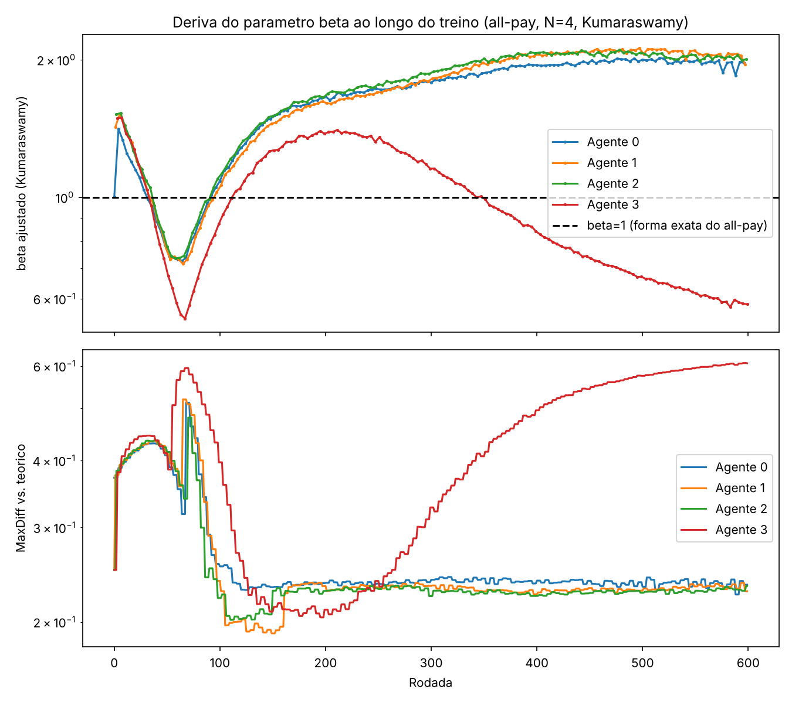

# Kumaraswamy critic: nesting the right answer isn't enough

**Status: negative result, well explained.** `KumaraswamyCritic` works fine
where the equilibrium genuinely needs 2 shape parameters or where the
dynamics are otherwise well-behaved (first-price, any N tried), but is
*worse* than plain `BetaCritic` at all-pay N=4 despite exactly nesting
`BetaCritic`'s correct shape as a special case. Root cause identified and
confirmed directly: the extra free shape parameter drifts away from its
correct value during training, before the drift is even visible in the
usual convergence metrics.

## Motivation

`Kumaraswamy(a, b)` has a closed-form CDF, `F(x) = 1 - (1-x^a)^b`, unlike
the general `Beta(a, b)` (which needs the incomplete beta function). It
strictly generalizes `BetaCritic`: setting `b=1` gives
`F(x) = 1-(1-x^a) = x^a`, exactly `BetaCritic`'s CDF. Fitting stays
(almost) closed-form via the same exponential-transform trick used
elsewhere in this project: for fixed `a`, `X^a ~ Beta(1, b)` makes the MLE
of `b` closed-form, collapsing the full fit into a 1-D bounded search over
`a` alone (`scipy.optimize.minimize_scalar`), not a gradient-descent loop.
See `fictitious_play.critic.KumaraswamyCritic`'s docstring for the full
derivation. The hope: since `BetaCritic`'s only weakness is lacking a
second shape parameter (documented in `docs/findings_risk_aversion.md`),
adding one back — cheaply, in closed form — should only help, never hurt,
since the correct answer (`b=1`) is always reachable.

## First-price N=3: works as expected

Direct (non-homotopy) 150-round run, `sample_size=100_000`,
`belief_decay=0.95`: MSE drops cleanly and mostly monotonically from
`~1e-2` to `~5e-4`; learned bid functions track the theoretical curve
closely (with the same small `v~0.85` step artifact seen across several
other critics/experiments in this project — apparently a property of this
training setup in general, not any one critic). Unsurprising: first-price
is exactly the `b=1` case `KumaraswamyCritic` nests, so this is really
just `BetaCritic`'s known-good behavior inherited for free.

## All-pay N=4: looked promising at 150 rounds, broke badly at 800

Same direct setup, `auction_type=all_pay`, `n_agents=4`,
`belief_decay=0.95`: at 150 rounds, MSE showed a real, consistent downward
trend (`3e-2` -> `~2e-3` by round ~110-120) — a notably *healthier*-looking
trajectory than `BetaCritic`/`MixtureBetaCritic` direct N=3/N=4 runs earlier
in this project, which tended to plateau flat almost immediately. Looked
like the second shape parameter was earning its keep.

**Resumed to 800 rounds total, same run**: the apparent progress reversed.
By round 800, 3 of the 4 agents (`MaxDiff ~0.22-0.23`) had converged to a
*shared but wrong* equilibrium — a steep, step-like bid function well above
the theoretical curve past `v~0.5` — while the 4th agent was left behind on
a near-linear, much lower bid function (reaching only `~0.13` at `v=1`
against a theoretical `~0.75`), winning far less often than its theoretical
share (payoff `~0.015-0.02` vs. the other three's `~0.04-0.05` and the
theoretical `0.05`).

**Tried a stronger belief buffer** (`belief_decay=0.98`, the upper end
`docs/findings_all_pay.md` suggests for taming all-pay's escalation),
same 150-round budget: made it *worse*, not better — the asymmetric split
was already severe by round 150 (`MaxDiff` `0.34` to `0.66` across the 4
agents), with two agents developing an extreme near-step bid function
(flat near 0 until `v~0.85`, then jumping to `~0.85-0.87`).

**Control: identical settings, `critic_type=beta`** (plain `BetaCritic`,
`belief_decay=0.98`, 150 rounds): converged cleanly. MSE drops sharply
around round 85-90 to `~1e-3` and stays there (noisy, `1e-3` to `4e-3`); all
4 learned bid functions sit almost on top of each other and track the
theoretical curve closely (a uniform, modest undershoot at the top —
`~0.55-0.65` vs. theoretical `~0.75` — not an asymmetric collapse). Same
auction, same N, same belief buffer, same round budget — the only
difference is the critic's shape family, and it's the difference between a
clean symmetric result and a broken asymmetric one.

## Why nesting the right answer didn't save it

`KumaraswamyCritic` *can* represent `BetaCritic`'s exact shape (`b=1`) —
confirmed directly, fitting a true power-law-shaped sample recovers `b~1`
cleanly (`tests/test_critic.py::test_kumaraswamy_critic_reduces_to_beta_at_b_equals_1`).
So in a *static* fitting sense, having the extra parameter can only help.
The critic here is never fit to a static sample, though — every round it's
re-fit to the belief buffer, which, before the game has settled, is a
genuine mixture of bids from different phases of the still-cycling
dynamics (not sampling noise — this non-stationarity-as-multimodality is
already documented in `docs/findings_all_pay.md`). That changes the
calculus:

- `BetaCritic`'s single shape parameter *cannot* bend to chase that
  transient multimodal structure — its MLE can only report the one
  power-law shape that best summarizes the whole noisy sample, acting as
  an involuntary low-pass filter that keeps the critic anchored near the
  true shape even while the data feeding it is still unsettled.
- `KumaraswamyCritic`'s second shape parameter gives it just enough
  freedom to start tracking that same transient structure round to round —
  not as much as `SplineCritic` (no shape constraint at all, already known
  unstable here), but evidently enough to feed a divergent loop: a
  slightly-off critic shape biases that round's best response, which
  changes next round's belief-buffer sample, which the flexible critic
  fits closely again instead of smoothing past.

**Confirmed directly, not just inferred.** Instrumented `KumaraswamyCritic.fit`
to log `(a, b)` every round in a fresh 600-round all-pay N=4 run
(`belief_decay=0.95`, no early stopping, so the whole trajectory is
visible):

| agent | `b` at round ~0 | mean `b`, first 20% of rounds | mean `b`, last 20% of rounds |
|---|---|---|---|
| 0 | 1.00 | 0.997 | 1.978 |
| 1 | 1.42 | 1.023 | 2.071 |
| 2 | 1.52 | 1.053 | 2.036 |
| 3 | 1.49 | 0.913 | 0.629 |

All four start near the correct `b=1`, dip briefly to `~0.7` during the
initial transient (rounds ~70-90), then **all four drift together** back
through `b=1` and up past it — and this happens *during* the stretch
(rounds ~100-250) where `MaxDiff` looks stable and converged (`~0.2-0.25`
for all agents): the drift away from the correct shape is already well
underway while the usual convergence metric still looks fine, precisely
because all four agents are drifting together and nothing looks
asymmetric yet. Only around round ~200-250 does the group split — agents
0, 1, 2 continue up to `b~2.0` and plateau there (a new, stable, *wrong*
fixed point, not runaway divergence); agent 3 reverses and heads down to
`b~0.6`. The visible `MaxDiff` blowup for agent 3 (climbing from `~0.25` to
`~0.6`) only starts *after* this split in `b`, lagging the root cause by
roughly 100-150 rounds.

Top: each agent's fitted `b`, log scale, dashed line at the true `b=1`.
Bottom: the same agents' `MaxDiff`. The split in `b` (top, ~round 200-250)
visibly precedes the split in `MaxDiff` (bottom, ~round 250 onward).

## Takeaway

Strictly nesting the correct model as a special case of a more flexible
family is not sufficient to guarantee as-good-or-better behavior inside an
iterated self-play loop, even though it's sufficient for a one-shot static
fit. The extra flexibility has to be weighed against what it does to the
loop's dynamics: a critic family that is *less* expressive than the truth
in general, but happens to be *exactly* correct at the specific auction's
equilibrium shape, can act as a stabilizing implicit regularizer precisely
*because* it cannot represent the transient non-equilibrium noise the loop
generates along the way — a property that is easy to lose the moment a
second free shape parameter is added back in, even one that is never
*needed* at the true equilibrium.

Practical rule of thumb this adds to the project's running theme (see
`docs/visao_geral.md`): before reaching for a more flexible critic because
a rigid one *might* be slightly biased, check whether the rigid one is
already *exact* at this auction's equilibrium (first-price, all-pay, the
`payment_share` continuum — see `docs/findings_beta_critic.md`). If so,
prefer it even when a strictly more general family is available and cheap
to fit; the extra freedom is a real liability here, not a free upgrade.
Reserve the added flexibility (`MixtureBetaCritic`, `KumaraswamyCritic`,
`MonotonicNNCritic`) for cases where the rigid family is genuinely
misspecified at the true equilibrium, like asymmetric risk-aversion.

## Open questions

- Not yet checked whether `KumaraswamyCritic` behaves better at all-pay
  N=4 when reached via N-continuation (warm-started from a converged N=2
  or N=3 solution) rather than trained from a cold N=4 start — the
  cold-start non-stationarity that seems to drive the `b`-drift might be
  much milder when each growth stage starts already close to equilibrium.
- Not yet checked at first-price or all-pay with N=2 (only N=3 first-price
  and N=4 all-pay were tried) — worth confirming whether N=2 all-pay
  (known much easier, see `docs/findings_beta_critic.md`) also shows the
  `b`-drift pattern, just too mild to visibly break convergence, or
  whether it's specific to N>=3's harder dynamics.
- The instrumented run disabled early stopping to see the full trajectory;
  worth checking whether `max_diff_threshold`-triggered early stopping
  would have caught the agents during the round~100-250 "looks converged"
  window in a real (non-diagnostic) run, silently reporting success on a
  configuration that was already mid-drift toward the later collapse.
